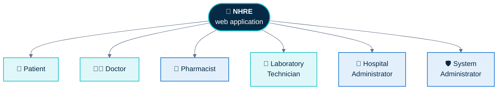
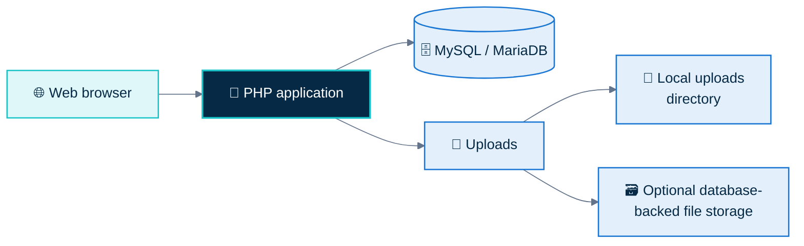

<div align="center">



<a href="https://national-healthcare-record-exchange-production.up.railway.app/">
  
</a>

<br>

<a href="https://national-healthcare-record-exchange-production.up.railway.app/">
  
</a>
<a href="#-quick-start">
  
</a>
<a href="#-demo-accounts">
  
</a>

<br><br>


<br><br>

<a href="https://national-healthcare-record-exchange-production.up.railway.app/">
  
</a>

<sub><b>A first look at NHRE</b> · click the image to open the live demo</sub>

<br><br>

<a href="#-overview">Overview</a> &nbsp;·&nbsp;
<a href="#-key-features">Features</a> &nbsp;·&nbsp;
<a href="#-role-based-workspaces">Roles</a> &nbsp;·&nbsp;
<a href="#-architecture">Architecture</a> &nbsp;·&nbsp;
<a href="#-technology-stack">Stack</a> &nbsp;·&nbsp;
<a href="#-quick-start">Quick Start</a> &nbsp;·&nbsp;
<a href="#-configuration">Config</a> &nbsp;·&nbsp;
<a href="#-demo-accounts">Demo</a> &nbsp;·&nbsp;
<a href="#-railway-deployment">Deploy</a> &nbsp;·&nbsp;
<a href="#-security-notes">Security</a>

</div>

<br>

> [!WARNING]
> **Prototype / Academic Project**
>
> NHRE is a demonstration prototype, not a certified medical records system. Do not use it with real patient data without appropriate security, privacy, regulatory, and clinical review.


## ✨ Overview

NHRE is a PHP and MySQL prototype that brings several healthcare-related workflows into **one role-based web application**. It shows how separate workspaces can support appointments, health records, consent-based data access, laboratory and vaccination workflows, pharmacy activity, and notifications.

Each account is tied to a role, and the interface and available actions change accordingly. The project is intended for **learning, local demonstrations, and portfolio review** — not for clinical use.

<div align="center">

<table>
  <tr>
    <td align="center" width="25%"><h3>👥 6</h3><sub>Role-based<br>workspaces</sub></td>
    <td align="center" width="25%"><h3>🧩 9</h3><sub>Feature<br>areas</sub></td>
    <td align="center" width="25%"><h3>🗄️ MySQL</h3><sub>8 / MariaDB<br>via PDO</sub></td>
    <td align="center" width="25%"><h3>🚂 Live</h3><sub>Docker on<br>Railway</sub></td>
  </tr>
</table>

</div>


## 🧩 Key features

<table>
  <tr>
    <td width="33%" valign="top">
      <h4>🔐 Authentication</h4>
      Registration and login, password hashing, CSRF checks, session handling, remember-me support, and failed-login tracking.
    </td>
    <td width="33%" valign="top">
      <h4>🩺 Patient records</h4>
      Medical records, allergies, medical documents, profile details, and patient-facing record workflows.
    </td>
    <td width="33%" valign="top">
      <h4>📅 Appointments</h4>
      Appointment booking and management for patients, doctors, and administrators.
    </td>
  </tr>
  <tr>
    <td valign="top">
      <h4>🤝 Consent &amp; data access</h4>
      Access requests, patient grant/revoke actions, and access records for supported workflows.
    </td>
    <td valign="top">
      <h4>🧪 Laboratory</h4>
      Test booking and requests, test history, and laboratory report/result workflows.
    </td>
    <td valign="top">
      <h4>💉 Vaccination</h4>
      Vaccination center information, bookings, and role-specific vaccination workflows.
    </td>
  </tr>
  <tr>
    <td valign="top">
      <h4>💊 Pharmacy</h4>
      Medicine catalog and inventory, prescriptions, dispensing workflows, and pharmacy requests.
    </td>
    <td valign="top">
      <h4>🔔 Notifications</h4>
      A notification center with read state and links to related application pages.
    </td>
    <td valign="top">
      <h4>🏥 Administration</h4>
      Hospital profile and account-management areas, system administration, reports, and audit-log views.
    </td>
  </tr>
</table>


## 👥 Role-based workspaces

The navigation and access checks in the application define these role workspaces:

<table>
  <tr>
    <td width="33%" valign="top">
      <h4>🧑 Patient</h4>
      Medical records and documents, appointments, prescriptions, pharmacy, test booking, vaccinations, allergies, blood information, and data access.
    </td>
    <td width="33%" valign="top">
      <h4>👨‍⚕️ Doctor</h4>
      Patient search, patient list, appointments, medical records, prescriptions, lab reports, documents, and access requests.
    </td>
    <td width="33%" valign="top">
      <h4>💊 Pharmacist</h4>
      Pharmacy, prescriptions, medicine inventory, stock management, dispensing history, reports, and audit log.
    </td>
  </tr>
  <tr>
    <td valign="top">
      <h4>🔬 Laboratory Technician</h4>
      Test requests, vaccination bookings, laboratory reports, patient search, and test history.
    </td>
    <td valign="top">
      <h4>🏥 Hospital Administrator</h4>
      Hospital profile, hospital account directory, appointments, laboratory services, records, access requests, reports, and audit logs.
    </td>
    <td valign="top">
      <h4>🛡️ System Administrator</h4>
      User and organization management, roles and permissions, patient administration, data exchange, reports, and audit logs.
    </td>
  </tr>
</table>




## 📐 Architecture

NHRE is a server-rendered PHP application. Pages and request handlers use PDO to access MySQL or MariaDB. Local development stores uploaded files on the filesystem; hosted deployments can configure MySQL-backed sessions and file storage.




## 🧰 Technology stack

<div align="center">


<br>


</div>

<br>

| Layer | Technology |
| --- | --- |
| Server-side application | PHP 8.1+ |
| Database | MySQL 8 or MariaDB |
| Database access | PDO MySQL |
| Web server / local development | Apache (including XAMPP) or PHP's built-in development server |
| Container deployment | Docker |
| Hosted deployment | Railway |
| Interface | HTML, CSS, JavaScript, Bootstrap 5, and Font Awesome |


## 📁 Project structure

```text
.
├── assets/                 # Stylesheets, JavaScript, and images
├── auth/                   # Authentication, request handlers, uploads, downloads
├── config/                 # Database, session, and file-storage configuration
├── database/
│   └── nhre.sql            # Initial schema and seed data
├── includes/               # Shared navigation and pharmacy helpers
├── uploads/                # Local upload storage
├── Dockerfile              # Apache/PHP container for Railway
├── .env.example            # Hosted environment-variable names
├── login.php               # Login page
└── README.md
```


## 📋 Requirements

- ✅ PHP 8.1 or later with PDO MySQL, Fileinfo, and standard session/file-upload support
- ✅ MySQL 8 or MariaDB
- ✅ Apache (XAMPP is supported) or PHP's built-in development server
- ✅ Docker when building or running the provided container


## ⚡ Quick start

> [!TIP]
> Just want to look around? Skip the setup and open the **[live demo](https://national-healthcare-record-exchange-production.up.railway.app/)**.

### 1️⃣ Configure the database

Start MySQL and import the schema from the repository root:

```bash
mysql -u root < database/nhre.sql
```

Alternatively, import `database/nhre.sql` using phpMyAdmin.

### 2️⃣ Check local database settings

The default local connection is `127.0.0.1:3306`, database `nhre`, user `root`, and an empty password. Update [config/database.php](config/database.php) or set the environment variables described in [Configuration](#-configuration).

### 3️⃣ Start the application

From the repository root, run PHP's built-in development server:

```bash
php -S 127.0.0.1:8000
```

Then open **[http://127.0.0.1:8000/](http://127.0.0.1:8000/)**.

<details>
<summary><b>🧱 Using XAMPP instead?</b></summary>

<br>

Place the repository in the Apache web root, start Apache and MySQL, and open the corresponding local project URL, for example `http://localhost/national-healthcare-record-exchange/`.

</details>


## 🔧 Configuration

The application reads database connection settings from environment variables. PHP does not load `.env` files automatically; configure variables in your shell or hosting provider. See [.env.example](.env.example) for the names.

| Variable | Purpose | Local default |
| --- | --- | --- |
| `DB_HOST` | MySQL host | `127.0.0.1` |
| `DB_PORT` | MySQL port | `3306` |
| `DB_NAME` | Database name | `nhre` |
| `DB_USER` | Database user | `root` |
| `DB_PASS` | Database password | Empty |
| `NHRE_SESSION_STORAGE` | Set to `database` to persist sessions in MySQL | PHP session storage |
| `NHRE_FILE_STORAGE` | Set to `database` to store uploads in MySQL | Local `uploads/` directory |

> [!NOTE]
> When database-backed storage is enabled, the application creates the `nhre_sessions` and `nhre_file_storage` support tables. The configured database user must have permission to create them.


## 🔑 Demo accounts

The login page provisions and displays demo accounts. Try the **[live demo](https://national-healthcare-record-exchange-production.up.railway.app/)** with any of these seeded credentials:

<details open>
<summary><b>👇 Seeded credentials (click to collapse)</b></summary>

<br>

| Role | Email | Password |
| --- | --- | --- |
| 🧑 Patient | `patient@nhre.gov` | `Patient123!` |
| 👨‍⚕️ Doctor | `doctor001@nhre.dev` | `Doctor123!` |
| 💊 Pharmacist | `pharmacist@nhre.gov` | `Pharmacist123!` |
| 🔬 Laboratory Technician | `lab@nhre.gov` | `Lab123!` |
| 🏥 Hospital Administrator | `admin@nhre.gov` | `Admin123!` |
| 🛡️ System Administrator | `sysadmin@nhre.gov` | `SysAdmin123!` |

</details>

> [!CAUTION]
> These are public demonstration credentials. Do not expose a deployment with demo accounts or default credentials to real users or real patient data.


## 🚂 Railway deployment

<div align="center">

<a href="https://national-healthcare-record-exchange-production.up.railway.app/">
  
</a>

</div>

<br>

The repository includes a [Dockerfile](Dockerfile) for deploying the PHP application to [Railway](https://railway.app/).

1. Deploy the GitHub repository as an app service and attach a Railway MySQL service.
2. Import `database/nhre.sql` into the MySQL service. If the provider already selects the target database or does not permit database creation, omit or adjust the schema's `CREATE DATABASE` and `USE nhre` statements.
3. In the app service's Variables settings, map `DB_HOST`, `DB_PORT`, `DB_NAME`, `DB_USER`, and `DB_PASS` to the MySQL service's `MYSQLHOST`, `MYSQLPORT`, `MYSQLDATABASE`, `MYSQLUSER`, and `MYSQLPASSWORD` variables. Set `NHRE_SESSION_STORAGE=database` and `NHRE_FILE_STORAGE=database` so sessions and uploads persist in MySQL.
4. Apply the variables and deploy. Open the app's public domain and verify `/` and `/login.php`.


## 🔒 Security notes

- NHRE is a prototype, not a certified medical records system or a production-ready clinical platform.
- Do not use real patient data without appropriate security, privacy, regulatory, and clinical review.
- For hosted demonstrations, use HTTPS and unique database credentials; never rely on public demo credentials for real users.
- Review authorization, audit logging, retention, backups, and applicable privacy requirements before any broader use.
- Password-reset flows are for demonstration and do not replace verified email delivery.
- Uploaded files and database contents may include sensitive information; secure, validate, and manage them appropriately.


## 📄 License

This project is licensed under the [MIT License](LICENSE).

<div align="center">

<br>

**If NHRE caught your eye, consider leaving a ⭐ on the repo!**

<a href="https://national-healthcare-record-exchange-production.up.railway.app/">
  
</a>

</div>


